# Alias-maker
a simplified terminal app. A terminal app that makes it easy for the most "clinically Linux challenged" person on the planet to use Linux and get the fucking job done!

> [!WARNING]
> **Install at your own risk.** Alias Maker has not been tested on a real machine yet. It's recommended that you install or run it in a virtual machine (for example CachyOS in GNOME Boxes, virt-manager or VirtualBox) until it has been.

## What it is

> The pictures in this README are mockups drawn from the code, not screenshots: Alias Maker hasn't been run on a real PC yet. The PC details in them are made up. All of them are in [docs/mockups](docs/mockups/).

Alias Maker is its own terminal app, a window like Konsole running your normal shell. Its ☰ menu adds:

```
Database
Custom Commands  ▸   Custom Command List
                     Create Command
                     Edit Command
                     Delete Command
Create Command
Terminal Settings
...
Report a Problem     crash reports and a health check (Alias Maker Debug)
```

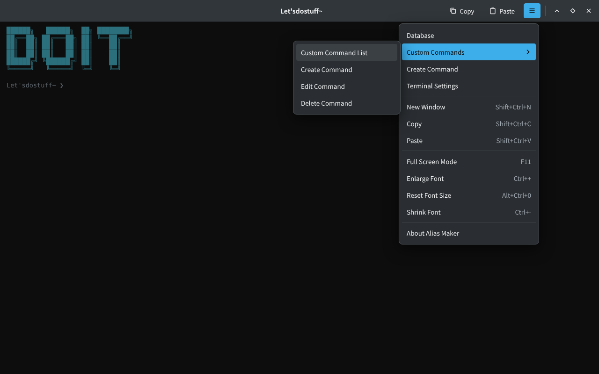

- **Database:** every program installed on your PC in a spreadsheet-style table (Command, What it does, Package, Location), searchable by what it does ("drives", "wifi", "battery"), with the best match on top (search "drives" and `lsblk` comes first). Click a column title to sort by it. Alias Maker scans your installed software the first time it opens, and again by itself whenever you install or remove something, so it only ever lists commands that work on your PC. It also checks which system you're on (CachyOS, SteamOS, Arch, Ubuntu, Debian, Fedora…) and reads package details the way that system keeps them: pacman on Arch-based systems, dpkg on Ubuntu and Debian. Pick a program to read its manual, type it into the terminal, or make a custom command for it. It opens in its own window, the table builds up row by row, and it's read-only.

  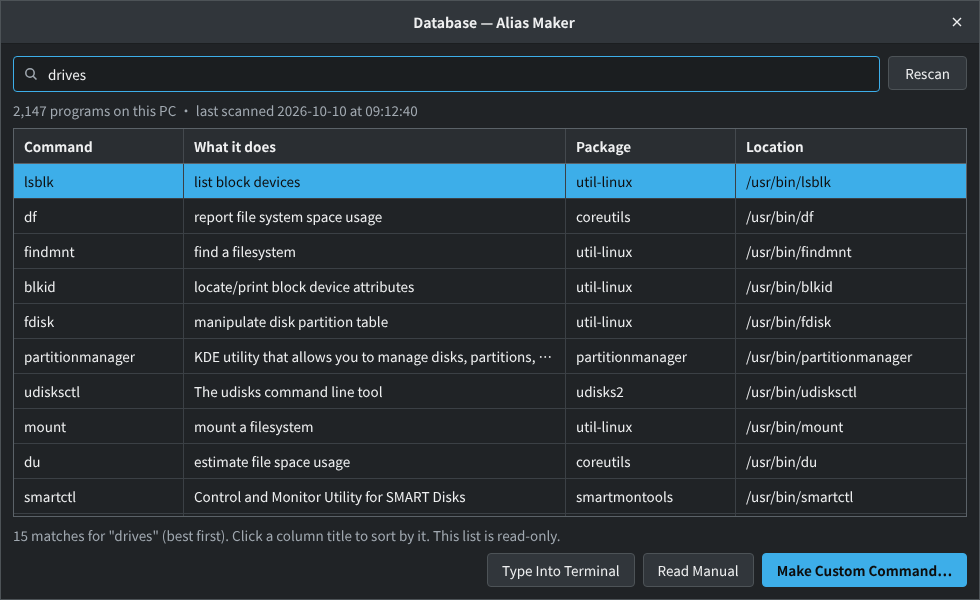

- **Create Command:** make your own phrase for any command, with no word restrictions. Make `just check my fucking drives` run `lsblk -f`, then type `doit just check my fucking drives` in the terminal. It always shows the real command first.

  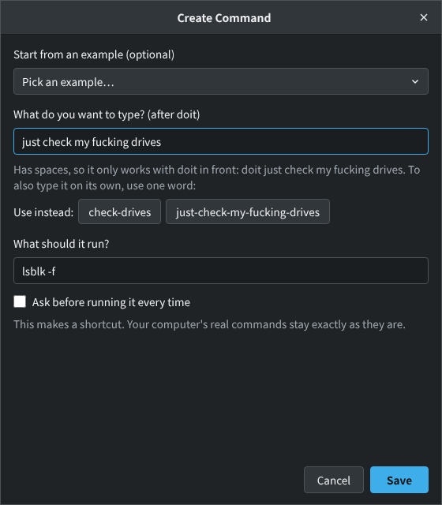

- **Custom Commands:** appears once you've made your first command. It's a second database, in the same kind of table (You type, It runs, Asks first, Made on), that lists only the commands you made, with Create, Edit and Delete. It's the one table you can edit directly: click a cell and type (Enter saves, Esc undoes), or tick and untick Asks first.

  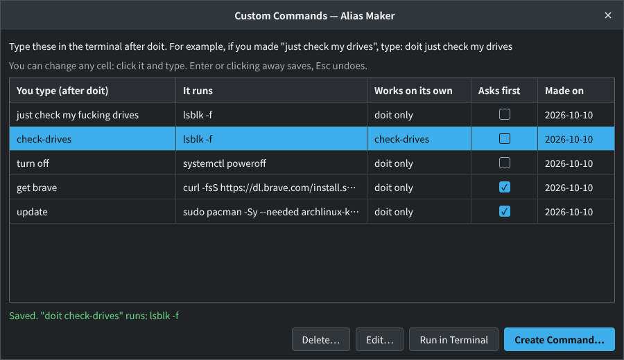

- **Terminal Settings:** turn the command log on or off, and open the **Command Log**: a table of every command doit ran (when, what you typed, the real command, whether it worked), newest first. If something gets messed up, this is where you check what happened. You also choose how to say yes here: "y or yes", only "yes", or your own word.

  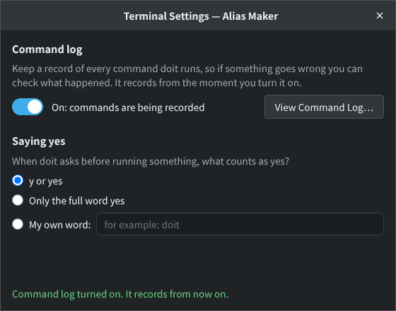

  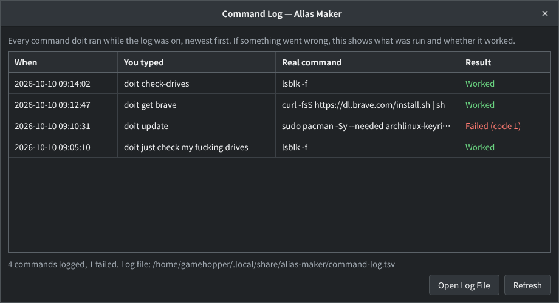

**Deleting a command only deletes your alias.** The real command it points to is never deleted or changed, so nothing on your computer can break. Your aliases only work after `doit`, so they can't replace or interfere with your computer's real commands either: an alias called `ls` doesn't change `ls`.

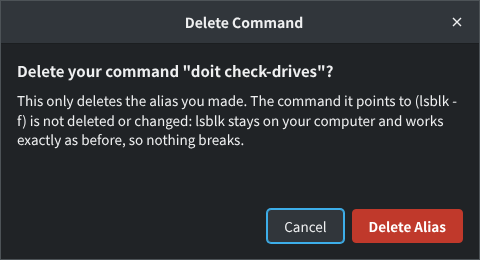

**It's yours, so it says so:** where other terminals show `fish ~`, Alias Maker says **Let'sdostuff~**, both in the title and on the line where you type:

```
Let'sdostuff~ ❯
Let'sdostuff~/Games ❯
```

Every Alias Maker window opens with a big DOIT and your PC's info next to it (from fastfetch when it's installed, as on CachyOS, or Alias Maker's own when it isn't):

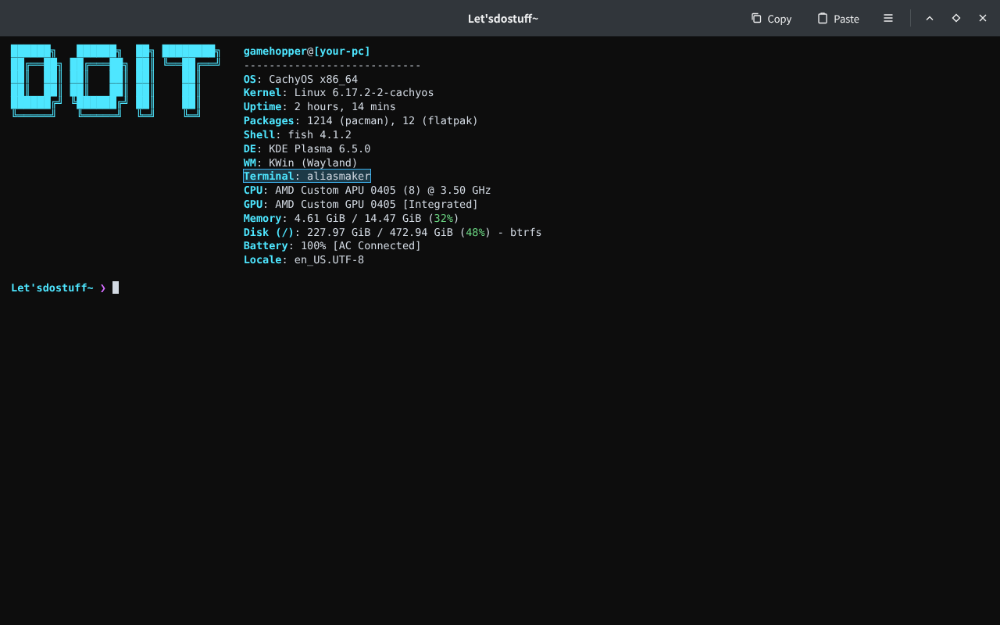

The folder after it still tells you where you are (`~` is your home folder), and the ❯ turns red when the last command failed. It's still the same fish underneath, with all your settings, and only inside Alias Maker.

**/clippy, the helper:** type `/clippy` and what you're wondering about, and it looks it up instead of running anything. As soon as you press space, `/clippy` turns into `doit clippy` (so it's never shown in red as an unknown command):

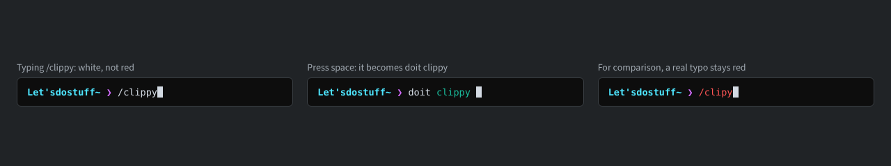

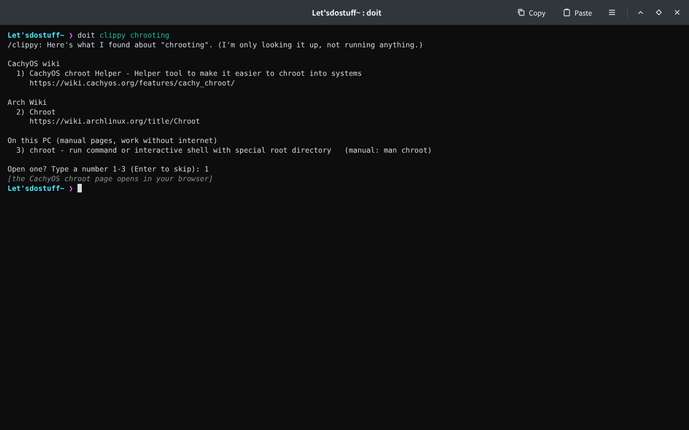

Pick a number and the page opens in your browser, or the manual opens right in the terminal. Plain questions work too: `/clippy how do I set up gaming`. Without internet it still shows what's on your PC (and wiki pages it saw before). It's not AI: it only shows real pages. `doit clippy chrooting` does the same thing.

The rest of the menu works like Konsole's: New Window, Copy, Paste, Full Screen, and font size, with the same shortcuts.

## Install

**The easy way: the installer.** Download [alias-maker-installer.run](https://github.com/theStyleWithin/Alias-maker/releases/latest/download/alias-maker-installer.run) (always the newest version; older ones are on the [Releases page](https://github.com/theStyleWithin/Alias-maker/releases)), then in a terminal:

```
bash ~/Downloads/alias-maker-installer.run
```

It asks before doing anything, then:

1. installs what Alias Maker needs from CachyOS's own repos (GTK 4, VTE, PyGObject), and offers the recommended extras that are missing (fish, fastfetch, manual pages, xdg-utils)
2. builds Alias Maker into a normal pacman package and installs it

It asks for your password; run it as yourself, not with `sudo`. Afterwards, open **Alias Maker** from your app launcher, or type `aliasmaker`. To make it your default terminal: System Settings → Default Applications → Terminal emulator → Alias Maker.

To uninstall: `bash alias-maker-installer.run --uninstall`, or `sudo pacman -R alias-maker`. Your own commands and settings (`~/.config/alias-maker`, `~/.local/share/alias-maker`) are kept either way.

**Other ways,** all on the [Releases page](https://github.com/theStyleWithin/Alias-maker/releases) under "Assets":

- **Ready-made package** for CachyOS / Arch: `sudo pacman -U ~/Downloads/alias-maker-<version>-1-any.pkg.tar.zst`
- **AUR / Flathub:** not published by the author; if someone packages it there, it'll be under their name (see [Publishing](#publishing)).
- **AppImage:** [Alias-Maker-x86_64.AppImage](https://github.com/theStyleWithin/Alias-maker/releases/latest/download/Alias-Maker-x86_64.AppImage), nothing to install. It uses your PC's GTK 4 and VTE (CachyOS: `sudo pacman -S vte4 python-gobject`) and says what's missing if they aren't there. Make it runnable (right-click → Properties → Allow executing, or `chmod +x`), then double-click it. One-word commands you make in it keep working in other terminals as long as the AppImage file stays where it is.
- **Alias Maker Debug as an AppImage:** [Alias-Maker-Debug-x86_64.AppImage](https://github.com/theStyleWithin/Alias-maker/releases/latest/download/Alias-Maker-Debug-x86_64.AppImage), for testers whose Alias Maker won't start at all. Without GTK it still saves the report and says where.

**Antivirus warnings about the AppImage.** A few antivirus engines (for example on VirusTotal) flag AppImages in general: the small launcher inside every AppImage is a compressed, self-unpacking program, and that looks like a packed virus to them. Alias Maker's AppImage was checked file by file: it's AppImage's official, unmodified launcher plus Alias Maker's own Python and shell files from this repo, nothing else. It's a false positive. To check that a download is the genuine one, built by GitHub from this repo's public source (each release has a `SHA256SUMS` file and a signed build record):

```
sha256sum -c SHA256SUMS --ignore-missing
gh attestation verify Alias-Maker-x86_64.AppImage --repo theStyleWithin/Alias-maker
```

If you'd rather avoid AppImages, the installer and the pacman package hold plain scripts and files you can read.

**From the source (for working on Alias Maker itself):**

```
sudo pacman -S vte4 python-gobject man-db man-pages
git clone https://github.com/theStyleWithin/Alias-maker.git
cd Alias-maker
./install.sh
```

`install.sh` runs Alias Maker straight from the cloned folder, for your user only. Don't use both ways at once: the `install.sh` copy in `~/.local/bin` would run instead of the installed one.

### Publishing

To publish a version, change `VERSION` in `src/aliasmaker_core.py` on `main`. The Release workflow (`.github/workflows/release.yml`) then runs the tests, builds every package and publishes a release with all of them: the installer (`packaging/build-installer.sh`), the AppImages (`packaging/build-appimage.sh`), and the pacman package and AUR files (`packaging/build-arch.sh`, run in an Arch container). The installer carries `packaging/arch/PKGBUILD` and the source, and runs `makepkg` on the user's PC.

**AUR and Flathub: packagers wanted.** Alias Maker's author doesn't publish on the AUR or Flathub. Anyone is welcome to package it there under their own account. Every release carries hand-off kits, `alias-maker-aur-handoff.tar.gz` (ready to publish) and `alias-maker-flathub-handoff.tar.gz` (a manifest plus the code changes a Flatpak needs). See [packaging/handoff](packaging/handoff/README.md).

## For testers: Alias Maker Debug

Alias Maker is being tested, so it comes with **Alias Maker Debug**, a separate small app that's always there: in your app launcher, in Alias Maker's ☰ menu as **Report a Problem**, or by typing `aliasmaker-debug`. It only needs GTK, not the terminal part, so it still opens when Alias Maker itself won't.

- **Crash reports, made by themselves.** When Alias Maker crashes or hits an error, it saves a report: what went wrong, where in Alias Maker's code, the last few menu items used, and the PC's basics (Alias Maker version, OS, kernel, desktop, GTK and VTE versions). You don't type anything. Even sudden crashes (Alias Maker just vanishing) are caught: the next time it opens, it says so and the report is waiting. ☰ → Report a Problem shows how many reports are new.
- **Private by design.** Reports never include anything typed or shown in the terminal. Before a report is saved, your user name, PC name, home folder, email addresses, IP addresses, passwords, long tokens and your own custom commands are replaced with `<user>`, `<pc>`, `~`, `<email>`, `<ip>`, `<hidden>` and `<your command>`. Reports stay on your PC (`~/.local/share/alias-maker/crashes/`), nothing is ever sent by itself, and you can read every word before sharing.
- **Health check:** checks that everything Alias Maker needs is installed (Python, PyGObject, GTK 4, VTE, fish, fastfetch, manual pages) and that its files are readable, and says what to install to fix each problem.
- **Sharing:** **Save Everything for the Developer** puts the health check and every report into one file in your Downloads folder, the one thing to send. Or Copy Report, Save Report, or **Report on GitHub** (opens a new issue with the report copied, ready to paste).
- **Test the Crash Recorder** makes a harmless test report, to check that it all works.

No desktop? `aliasmaker-debug --text` does the same in any terminal, and `aliasmaker-debug --save-all` saves the one file straight away.

## Inside the terminal

Everything you type normally still works. `doit` runs the commands **you** make. It comes with a few built-in words so it knows how to help:

| Type | What happens |
|---|---|
| `doit` | Asks "Do what? I am waiting..." and waits for you |
| `doit <your phrase>` | Runs one of your commands |
| `<your one-word command>` | One-word commands also work on their own, like `check-drives` (see below) |
| `doit create` | Creates a command from the terminal, step by step (same as Create Command in the menu) |
| `doit forget <phrase>` or `doit delete <phrase>` | Deletes one of your commands, e.g. `doit forget just check my fucking drives`. Only your alias is deleted, never the real command |
| `/clippy <topic>` | Looks a topic up instead of running it |
| `doit help` | What doit understands, plus the example commands |
| `doit show me what you did` | Your command history, if logging is on (the full log is in ☰ → Terminal Settings) |
| `doit logging on` / `off` | Turn the command log on or off |
| `doit answer strict` | Saying yes needs the full word "yes" (`doit answer easy` goes back to y/yes) |
| `doit answer word <word>` | Pick your own yes word |

### Your commands are real terminal commands

The old-fashioned way to make a shortcut on CachyOS is to edit fish's config file by hand and add lines like `alias update='…'`. Alias Maker does that part for you: it keeps its own file, `~/.config/fish/conf.d/alias-maker.fish`, and rewrites it every time you create, edit or delete a command. Fish loads it in every terminal window, Konsole included. Your own `config.fish` and CachyOS's settings are never touched, and you never need to open the file.

One rule: **a terminal command can't have spaces.** The terminal reads the first word as the command, so `just check my fucking drives` would make it look for a program called `just`. When you name a command with spaces, Alias Maker offers one-word versions:

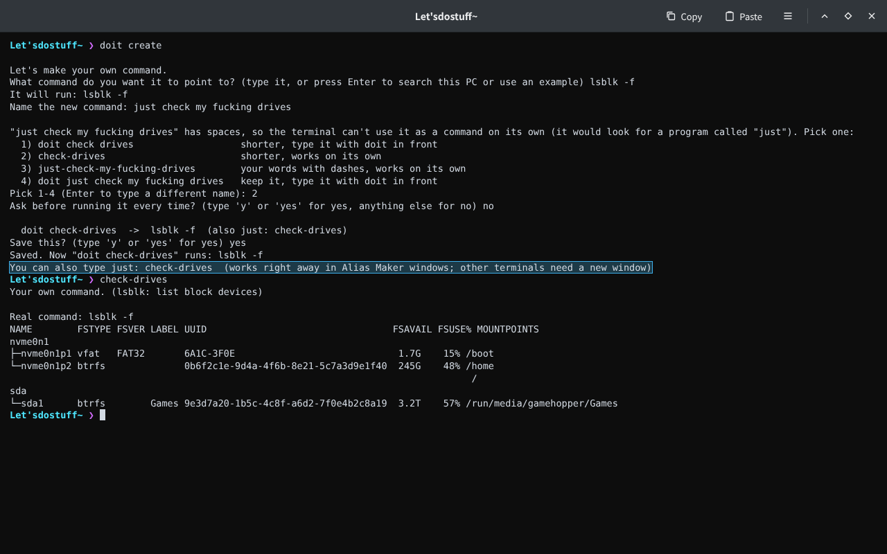

- **One-word names** (like `check-drives`) work on their own and with `doit` in front.
- **Names with spaces** work with `doit` in front.
- **Names that are already taken** (a program like `ls`, a fish command like `cd`, or one of CachyOS's shortcuts like `update`) work as `doit <name>` only, so the real one is never hidden.

Shortcuts still go through Alias Maker: they show the real command first, ask before running when set to, and are logged. Extra words are passed along, so `check-drives /dev/sda` runs `lsblk -f /dev/sda`. In Alias Maker, a new one-word command works right away in every open window. Other terminals (like Konsole) pick it up in a new window.

### Example commands you can make

Alias Maker doesn't come with ready-made commands. These are examples to get you started: pick one in **Create Command** (or `doit create`), name it whatever you like, and save it. You're only offered the ones that fit your PC: "update my system" uses pacman on CachyOS and Arch, apt on Ubuntu and Debian, and dnf on Fedora (SteamOS's system is read-only, so there it's "update my apps" with `flatpak update` instead), and "take a snapshot" only appears if snapper is installed.

**When a command isn't found,** Alias Maker says why in plain words instead of just "Unknown command": a typo (with programs you have that have a similar name), software that isn't installed (plus your system's own hint on which package has it, when it has one), or one of your own phrases typed without `doit` in front.

| Example phrase | What it would run | What it does |
|---|---|---|
| `doit turn off` | `systemctl poweroff` | Shuts the computer down |
| `doit restart` | `systemctl reboot` | Restarts the computer |
| `doit disk space` | `df -h` | Shows how full each drive is |
| `doit update my system` | refreshes the signing keys, then updates everything | Updates your whole system (asks first) |
| `doit take a snapshot` | `snapper create` | Saves a restore point (asks first) |
| `doit install brave` | the installation command from Brave's own guide | Points to the Brave browser installation command in the Brave browser guide and installs Brave easily. Shows where the installer comes from and asks first |

`doit create` and `doit forget` are for anyone who'd rather get used to the terminal than use the menu. Browsing and searching the Database, and editing commands, happen in the window (☰ → Database, ☰ → Custom Commands).

Practice safely: `doit --dry-run <phrase>` shows what would run without running it.

To remove an `install.sh` copy: `rm ~/.local/bin/aliasmaker ~/.local/bin/doit ~/.local/bin/aliasmaker-debug ~/.local/share/applications/aliasmaker.desktop ~/.local/share/applications/aliasmaker-debug.desktop`. Your settings and custom commands live in `~/.config/alias-maker`, and the Database and log in `~/.local/share/alias-maker`.

Design notes and what's next: [docs/DESIGN.md](docs/DESIGN.md). Part of the [Do It OS](https://github.com/theStyleWithin/Doit-os) project.

To run the tests: `python3 -m unittest discover -s tests`
