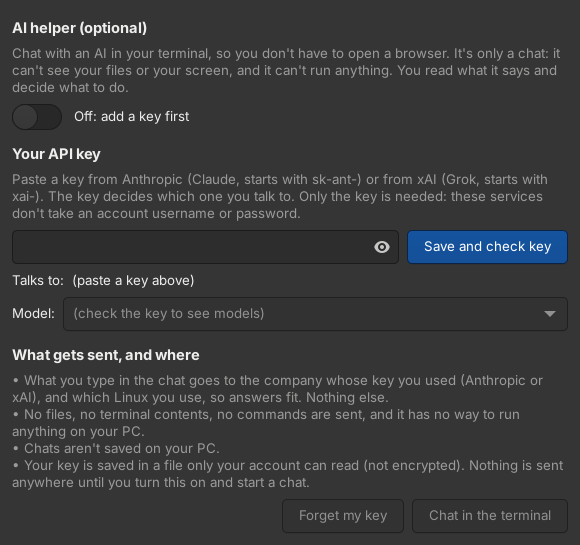
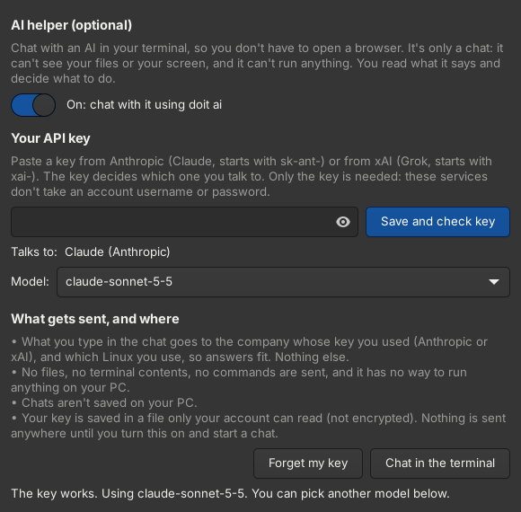
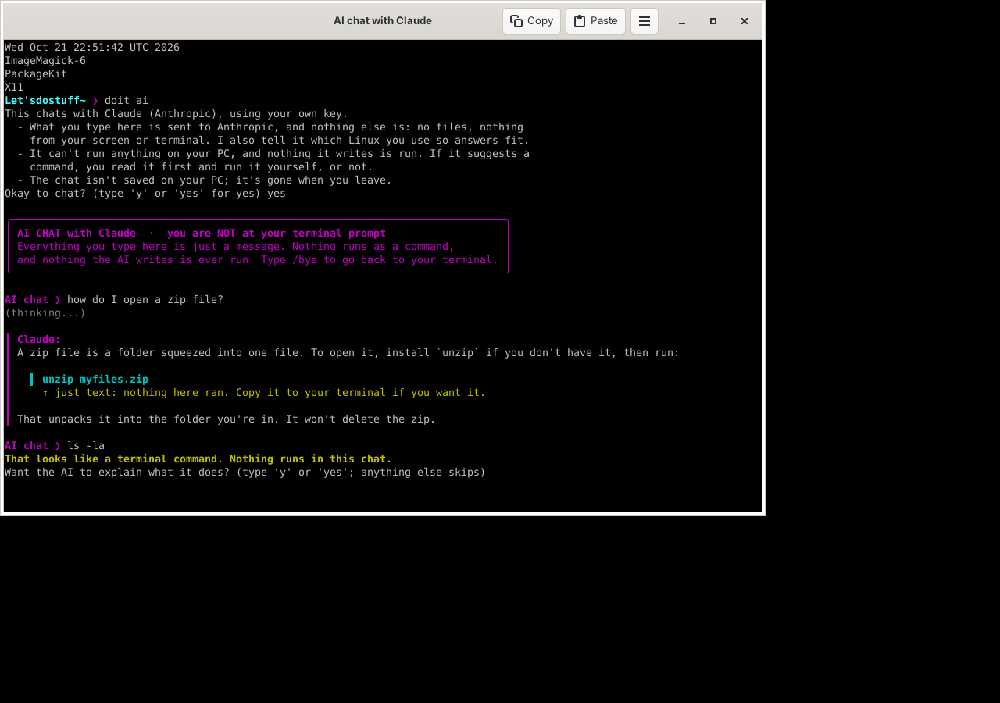

# Alias-maker
a simplified terminal app. A terminal app that makes it easy for the most "clinically Linux challenged" person on the planet to use Linux and get the fucking job done!

> [!WARNING]
> **Early version: use at your own risk.** Alias Maker is new. So far it has been run on one real Steam Deck (SteamOS) and on clean Ubuntu test systems, and not yet on other PCs. If you'd rather be careful, try it in a virtual machine first. If something goes wrong, open **Alias Maker Debug** and send the report file it saves.

## What it is

**Feature complete for now.** The author considers the project feature complete for the moment; from here it's testing and fixing what breaks. `/clippy` is a helpful command that searches the web from the terminal for answers. It isn't AI: it only shows real pages, and it makes the terminal feel less scary for people who are new to Linux.

> The pictures in this README are mockups drawn from the code, not screenshots: Alias Maker hasn't been run on a real PC yet. The PC details in them are made up. All of them are in [docs/mockups](docs/mockups/).

Alias Maker is its own terminal app, a window like Konsole running your normal shell. Its ☰ menu adds:

```
Database
Custom Commands  ▸   Custom Command List
                     Create Command
                     Edit Command
                     Delete Command
Create Command
Terminal Settings
...
Report a Problem     crash reports and a health check (Alias Maker Debug)
```


- **Database:** every program installed on your PC in a spreadsheet-style table (Command, What it does, Package, Location), searchable by what it does ("drives", "wifi", "battery"), with the best match on top (search "drives" and `lsblk` comes first). Click a column title to sort by it. Alias Maker scans your installed software the first time it opens, and again by itself whenever you install or remove something, so it only ever lists commands that work on your PC. It also checks which system you're on (CachyOS, SteamOS, Arch, Ubuntu, Debian, Fedora…) and reads package details the way that system keeps them: pacman on Arch-based systems, dpkg on Ubuntu and Debian. It finds out which shell your PC uses (bash or fish) and lists that shell's own commands too (`cd`, `export`, `alias`…, marked as built into bash), because those are commands your PC understands even though they aren't programs. Pick a program to read its manual, type it into the terminal, or make a custom command for it. It opens in its own window, the table builds up row by row, and it's read-only.

  

- **Create Command:** make your own phrase for any command, with no word restrictions. Make `just check my fucking drives` run `lsblk -f`, then type `doit just check my fucking drives` in the terminal. It always shows the real command first.

  

- **Custom Commands:** appears once you've made your first command. It's a second database, in the same kind of table (You type, It runs, Asks first, Made on), that lists only the commands you made, with Create, Edit and Delete. It's the one table you can edit directly: click a cell and type (Enter saves, Esc undoes), or tick and untick Asks first.

  

- **Terminal Settings:** turn the command log on or off, and open the **Command Log**: a table of every command doit ran (when, what you typed, the real command, whether it worked), newest first. If something gets messed up, this is where you check what happened. You also choose how to say yes here: "y or yes", only "yes", or your own word.

  

  

**Deleting a command only deletes your alias.** The real command it points to is never deleted or changed, so nothing on your computer can break. Your aliases only work after `doit`, so they can't replace or interfere with your computer's real commands either: an alias called `ls` doesn't change `ls`.


**It's yours, so it says so:** where other terminals show `fish ~` or `[deck@steamdeck ~]$`, Alias Maker says **Let'sdostuff~**, both in the title and on the line where you type. It only paints that name over your prompt: underneath it's still your PC's own shell (fish on CachyOS, bash on SteamOS and Ubuntu), and your own settings, aliases and commands work as usual:

```
Let'sdostuff~ ❯
Let'sdostuff~/Games ❯
```

Every Alias Maker window opens with a big DOIT and your PC's info next to it (from fastfetch when it's installed, as on CachyOS, or Alias Maker's own when it isn't):


The folder after it still tells you where you are (`~` is your home folder), and the ❯ turns red when the last command failed. It's still the same shell underneath (your fish or bash, with all your settings), and the name is only painted on inside Alias Maker: other terminals stay as they were. To keep your own prompt, set `ALIASMAKER_KEEP_PROMPT=1`.

**Typo helper:** if you mistype a command and press Enter, nothing runs. Alias Maker says `This looks like a typo. Did you mean:` and lists up to three programs on your PC that are close (`lsbk` → `lsblk`, `sl` → `ls`, plus any one-word command you made). Type its number and it runs with the same words you typed (the full command is shown first); press Enter to skip. Programs that can change or remove things (`rm`, `dd`, package managers...) ask once more. It works in bash and fish.

**AI helper (optional, off until you set it up):** if you'd rather ask an AI than open a browser, ☰ → **AI** opens its own settings. Paste an API key and it connects to Claude (keys start with `sk-ant-`, from console.anthropic.com) or Grok (keys start with `xai-`, from console.x.ai): the key decides which one. Then type `/ai` (or `doit ai`) in the terminal and chat. Only the key is needed; the services don't take an account username or password, so Alias Maker never asks for one.

 

You can always tell where you are. At your normal prompt you see `Let'sdostuff~ ❯`. In an AI chat the window title says **AI chat with Claude**, a purple box says you are *not* at your terminal prompt, your prompt becomes `AI chat ❯`, and every line the AI writes has a purple bar beside it. A command the AI suggests is shown on its own line and marked "just text: nothing here ran". When you leave with `/bye`, it says "Back at your terminal: commands run again." If you type something that looks like a command into the chat (`ls -la`, `sudo ...`, one of your own commands), nothing runs: it says so and offers to have the AI explain it.



It's only a chat. It can't see your files or your screen, it has no way to run anything, and nothing it writes is ever run: if it suggests a command, you read it and decide. What you type goes to the company whose key you used (Anthropic or xAI), along with the name of your Linux so its commands fit; nothing else is sent. Chats aren't saved on your PC. Your key is kept in a file only your account can read (not encrypted). It's light: no extra programs, no background service, about 20 MB while a chat is open. Other words: `doit ai status`, `doit ai off`, `doit ai forget` (deletes the key), `doit ai setup` (type the key in the terminal instead).

**/clippy, the helper:** type `/clippy` and what you're wondering about, and it looks it up instead of running anything. As soon as you press space, `/clippy` turns into `doit clippy` (so it's never shown in red as an unknown command):


Press Enter and everything it found opens as one page in your browser (reading it is up to you), or type a number to open just that one, or the manual right in the terminal. Plain questions work too: `/clippy how do I set up gaming`. If you're too vague (`/clippy I need help`), it asks on the next line: `What do you need help with?`. A more specific answer narrows the search. Without internet it still shows what's on your PC (and wiki pages it saw before). It's not AI: it only shows real pages. `doit clippy chrooting` does the same thing.

The first time, `/clippy` asks whether it may also search question-and-answer sites (Ask Ubuntu, Unix & Linux on stackexchange.com). Your question is only sent there if you say yes; the answer is remembered. Change it any time with `doit clippy web on` or `doit clippy web off`.

`/clippy` points you at the documentation of the system Alias Maker detects on your PC: the CachyOS wiki on CachyOS, the Steam Community forums and the Arch Wiki on SteamOS (it's built on Arch), the Arch Wiki on Arch, the Manjaro wiki on Manjaro, the Linux Mint guide on Mint, Ubuntu's documentation on Ubuntu. It never sends you to another system's pages: if it doesn't know your system's documentation yet, it says so and only looks on your PC. The list lives in `data/docs.json` (one entry per system, easy to extend: Debian, Fedora and more are waiting for someone to add their documentation links).

The rest of the menu works like Konsole's: New Window, Copy, Paste, Full Screen, and font size, with the same shortcuts.

## Install

**The easy way: the installer.** Download [alias-maker-installer.run](https://github.com/theStyleWithin/Alias-maker/releases/latest/download/alias-maker-installer.run) (always the newest version; older ones are on the [Releases page](https://github.com/theStyleWithin/Alias-maker/releases)), then in a terminal:

```
bash ~/Downloads/alias-maker-installer.run
```

It asks before doing anything, then:

1. installs what Alias Maker needs from CachyOS's own repos (GTK 4, VTE, PyGObject), and offers the recommended extras that are missing (fish, fastfetch, manual pages, xdg-utils)
2. builds Alias Maker into a normal pacman package and installs it

It asks for your password; run it as yourself, not with `sudo`. Afterwards, open **Alias Maker** from your app launcher, or type `aliasmaker`. To make it your default terminal: System Settings → Default Applications → Terminal emulator → Alias Maker.

To uninstall: `bash alias-maker-installer.run --uninstall`, or `sudo pacman -R alias-maker`. Your own commands and settings (`~/.config/alias-maker`, `~/.local/share/alias-maker`) are kept either way.

**Other ways,** all on the [Releases page](https://github.com/theStyleWithin/Alias-maker/releases) under "Assets":

- **Ready-made package** for CachyOS / Arch: `sudo pacman -U ~/Downloads/alias-maker-<version>-1-any.pkg.tar.zst`
- **AUR / Flathub:** not published by the author; if someone packages it there, it'll be under their name (see [Publishing](#publishing)).
- **AppImage (recommended on SteamOS and anything that isn't CachyOS):** [Alias-Maker-x86_64.AppImage](https://github.com/theStyleWithin/Alias-maker/releases/latest/download/Alias-Maker-x86_64.AppImage). Nothing to install, nothing to ask: it carries its own Python, GTK 4 and VTE, and opens straight to the terminal. Make it runnable (right-click → Properties → Allow executing, or `chmod +x`), then double-click it. It needs a 64-bit PC with a graphical desktop and a C library of glibc 2.38 or newer (that's any 2024 distro, such as Ubuntu 24.04, Fedora 39 and newer, and a current SteamOS). The terminal runs the shell your PC already uses (bash on SteamOS and Ubuntu, fish on CachyOS), found when it starts; `ALIASMAKER_SHELL=/path/to/shell` picks another. One-word commands you make in it keep working in other terminals when your shell is fish; with bash they work in Alias Maker windows (other terminals know `doit <phrase>`), and the AppImage file has to stay where it is.
- **Alias Maker Debug as an AppImage:** [Alias-Maker-Debug-x86_64.AppImage](https://github.com/theStyleWithin/Alias-maker/releases/latest/download/Alias-Maker-Debug-x86_64.AppImage), the same self-contained build, opening Alias Maker Debug (crash reports and the health check) instead of the terminal.

**Antivirus warnings about the AppImage.** A few antivirus engines (for example on VirusTotal) flag some AppImages: the small launcher at the front of every AppImage is a compressed, self-unpacking program, which looks like a packed virus to them, and this one also carries a lot of ready-made programs. Everything inside comes from known places: Ubuntu 24.04's own Python, GTK 4, VTE and their libraries (stripped, with their library search path changed so they find each other inside the AppImage), AppImage's official launcher, and Alias Maker's own files from this repo. To check that a download is the genuine one, built by GitHub from this repo's public source (each release has a `SHA256SUMS` file and a signed build record):

```
sha256sum -c SHA256SUMS --ignore-missing
gh attestation verify Alias-Maker-x86_64.AppImage --repo theStyleWithin/Alias-maker
```

If you'd rather avoid AppImages, the installer and the pacman package hold plain scripts and files you can read (they use your own system's GTK, VTE and fish).

**From the source (for working on Alias Maker itself):**

```
sudo pacman -S vte4 python-gobject man-db man-pages
git clone https://github.com/theStyleWithin/Alias-maker.git
cd Alias-maker
./install.sh
```

`install.sh` runs Alias Maker straight from the cloned folder, for your user only. Don't use both ways at once: the `install.sh` copy in `~/.local/bin` would run instead of the installed one.

### Publishing

To publish a version, change `VERSION` in `src/aliasmaker_core.py` on `main`. The Release workflow (`.github/workflows/release.yml`) then runs the tests, builds every package and publishes a release with all of them: the installer (`packaging/build-installer.sh`), the AppImages (`packaging/build-appimage.sh`), and the pacman package and AUR files (`packaging/build-arch.sh`, run in an Arch container). The installer carries `packaging/arch/PKGBUILD` and the source, and runs `makepkg` on the user's PC.

**Scanning a build before sharing it.** The `Debug build (private draft)` workflow (Actions tab → Run workflow) builds the AppImages from any branch and puts them in a draft release that only people who can write to this repo can see, with a `SHA256SUMS` file, so they can be scanned for viruses first. It doesn't touch the public releases.

**AUR and Flathub: packagers wanted.** Alias Maker's author doesn't publish on the AUR or Flathub. Anyone is welcome to package it there under their own account. Every release carries hand-off kits, `alias-maker-aur-handoff.tar.gz` (ready to publish) and `alias-maker-flathub-handoff.tar.gz` (a manifest plus the code changes a Flatpak needs). See [packaging/handoff](packaging/handoff/README.md).

## What Alias Maker runs on your PC

Nothing is started that you don't see in a process list with its name on it, and nothing pops up on its own:

- **Opening the window:** one `aliasmaker` process (Python), and your own shell (bash or fish) inside it. The AppImage itself shows up once as `Alias-Maker-x86_64.AppImage`, its launcher.
- **While you use it:** `doit` starts for a moment each time you use it. The Database scan (when you first open it, and again after software is installed or removed) runs read-only helpers one after another for a second or two (`whatis`, and `pacman` or `dpkg-query`). It never runs the programs it lists.
- **Only if you ask:** `xdg-open` for a `/clippy` result, `man` for a manual page, and the commands you made.
- **Never:** pop-up dialogs, background services, or anything left running after you close the window. No network use except `/clippy`'s lookups on your own system's documentation sites, and only when you type `/clippy`. Question-and-answer sites (stackexchange.com) only if you said yes. The AI helper only talks to Anthropic or xAI, and only after you've added a key, turned it on and started a chat.

On a Steam Deck in desktop mode, some programs that draw with Vulkan get a "Gamescope WSI Layer Error" pop-up (that's a separate zenity window made by Valve's Gamescope layer). Alias Maker avoids it by drawing with OpenGL instead of Vulkan (and switching Vulkan off for itself), and the shell inside the window never sees that setting.

## For testers: Alias Maker Debug

Alias Maker is being tested, so it comes with **Alias Maker Debug**, a separate small app that's always there: in your app launcher, in Alias Maker's ☰ menu as **Report a Problem**, or by typing `aliasmaker-debug`. It only needs GTK, not the terminal part, so it still opens when Alias Maker itself won't.

- **Crash reports, made by themselves.** When Alias Maker crashes or hits an error, it saves a report: what went wrong, where in Alias Maker's code, the last few menu items used, and the PC's basics (Alias Maker version, OS, kernel, desktop, GTK and VTE versions). You don't type anything. Even sudden crashes (Alias Maker just vanishing) are caught: the next time it opens, it says so and the report is waiting. ☰ → Report a Problem shows how many reports are new.
- **Private by design.** Reports never include anything typed or shown in the terminal. Before a report is saved, your user name, PC name, home folder, email addresses, IP addresses, passwords, long tokens and your own custom commands are replaced with `<user>`, `<pc>`, `~`, `<email>`, `<ip>`, `<hidden>` and `<your command>`. Reports stay on your PC (`~/.local/share/alias-maker/crashes/`), nothing is ever sent by itself, and you can read every word before sharing.
- **Health check:** checks that everything Alias Maker needs is installed (Python, PyGObject, GTK 4, VTE, your shell, fastfetch, manual pages) and that its files are readable, and says what to install to fix each problem.
- **Sharing:** **Save Everything for the Developer** puts the health check and every report into one file in your Downloads folder, the one thing to send. Or Copy Report, Save Report, or **Report on GitHub** (opens a new issue with the report copied, ready to paste).
- **Test the Crash Recorder** makes a harmless test report, to check that it all works.

No desktop? `aliasmaker-debug --text` does the same in any terminal, and `aliasmaker-debug --save-all` saves the one file straight away.

## Inside the terminal

Everything you type normally still works. `doit` runs the commands **you** make. It comes with a few built-in words so it knows how to help:

| Type | What happens |
|---|---|
| `doit` | Asks "Do what? I am waiting..." and waits for you |
| `doit <your phrase>` | Runs one of your commands |
| `<your one-word command>` | One-word commands also work on their own, like `check-drives` (see below) |
| `doit create` | Creates a command from the terminal, step by step (same as Create Command in the menu) |
| `doit forget <phrase>` or `doit delete <phrase>` | Deletes one of your commands, e.g. `doit forget just check my fucking drives`. Only your alias is deleted, never the real command |
| `/clippy <topic>` | Looks a topic up instead of running it |
| `doit help` | What doit understands, plus the example commands |
| `doit show me what you did` | Your command history, if logging is on (the full log is in ☰ → Terminal Settings) |
| `doit logging on` / `off` | Turn the command log on or off |
| `doit answer strict` | Saying yes needs the full word "yes" (`doit answer easy` goes back to y/yes) |
| `doit answer word <word>` | Pick your own yes word |

### Your commands are real terminal commands

The old-fashioned way to make a shortcut is to edit your shell's config file by hand and add lines like `alias update='…'`. Alias Maker does that part for you. For bash it keeps `~/.config/alias-maker/shortcuts.bash` (read by Alias Maker windows only, so your `.bashrc` is never touched). For fish it keeps its own file, `~/.config/fish/conf.d/alias-maker.fish`, and rewrites it every time you create, edit or delete a command. Fish loads it in every terminal window, Konsole included. Your own `config.fish` and CachyOS's settings are never touched, and you never need to open the file.

One rule: **a terminal command can't have spaces.** The terminal reads the first word as the command, so `just check my fucking drives` would make it look for a program called `just`. When you name a command with spaces, Alias Maker offers one-word versions:


- **One-word names** (like `check-drives`) work on their own and with `doit` in front.
- **Names with spaces** work with `doit` in front.
- **Names that are already taken** (a program like `ls`, a built-in like `cd`, or one of your own or CachyOS's shortcuts like `update`) work as `doit <name>` only, so the real one is never hidden.

Shortcuts still go through Alias Maker: they show the real command first, ask before running when set to, and are logged. Extra words are passed along, so `check-drives /dev/sda` runs `lsblk -f /dev/sda`. In Alias Maker, a new one-word command works right away in every open window. Other terminals (like Konsole) pick it up in a new window.

### Example commands you can make

Alias Maker doesn't come with ready-made commands. These are examples to get you started: pick one in **Create Command** (or `doit create`), name it whatever you like, and save it. You're only offered the ones that fit your PC: "update my system" uses pacman on CachyOS, Arch and Manjaro (each with its own packages), apt on Ubuntu, Mint and Debian, dnf on Fedora, and zypper on openSUSE (SteamOS's system is read-only, so there it's "update my apps" with `flatpak update` instead), and "take a snapshot" only appears if snapper is installed.

If a command you saved calls a program this PC doesn't have (say it was made on another system), Alias Maker tells you in plain words before running anything. If it knows how your system does the same thing, it offers that instead, and only switches if you say yes. At the `Do what? I am waiting...` prompt you can type just the phrase, but typing `doit` first, quotes around it, or dashes instead of spaces also work. If you almost typed a command you made (a typo, say), it says "Did you mean" and asks if you want it; answer `y`, at that prompt or straight after `doit ...`.

**When a command isn't found,** Alias Maker says why in plain words instead of just "Unknown command": a typo (with programs you have that have a similar name), software that isn't installed (plus your system's own hint on which package has it, when it has one), or one of your own phrases typed without `doit` in front.

| Example phrase | What it would run | What it does |
|---|---|---|
| `doit turn off` | `systemctl poweroff` | Shuts the computer down |
| `doit restart` | `systemctl reboot` | Restarts the computer |
| `doit disk space` | `df -h` | Shows how full each drive is |
| `doit update my system` | refreshes the signing keys, then updates everything | Updates your whole system (asks first) |
| `doit take a snapshot` | `snapper create` | Saves a restore point (asks first) |
| `doit install brave` | the installation command from Brave's own guide | Points to the Brave browser installation command in the Brave browser guide and installs Brave easily. Shows where the installer comes from and asks first |

`doit create` and `doit forget` are for anyone who'd rather get used to the terminal than use the menu. Browsing and searching the Database, and editing commands, happen in the window (☰ → Database, ☰ → Custom Commands).

Practice safely: `doit --dry-run <phrase>` shows what would run without running it.

To remove an `install.sh` copy: `rm ~/.local/bin/aliasmaker ~/.local/bin/doit ~/.local/bin/aliasmaker-debug ~/.local/share/applications/aliasmaker.desktop ~/.local/share/applications/aliasmaker-debug.desktop`. Your settings and custom commands live in `~/.config/alias-maker`, and the Database and log in `~/.local/share/alias-maker`.

Design notes and what's next: [docs/DESIGN.md](docs/DESIGN.md). Part of the [Do It OS](https://github.com/theStyleWithin/Doit-os) project.

To run the tests: `python3 -m unittest discover -s tests`
